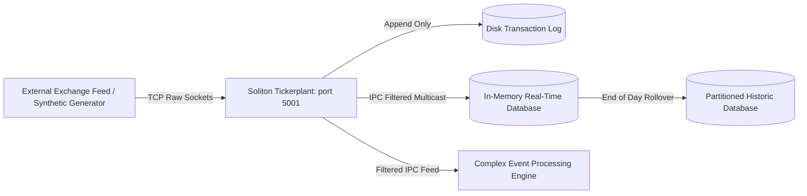

# Soliton System Architecture and Engine Internals

## 1. Engine Memory Layout and Object Model

The native C engine implements a unified array object model based on the classic `K` struct representation:

```
+-------------------------------------------------------------+
| K Object Header (8 bytes)                                   |
|   m (int8): memory flags     t (int8): type tag (-16..104)  |
|   u (int16): attributes      r (int32): reference count     |
+-------------------------------------------------------------+
| Union Body:                                                 |
|   - Scalar Atom: direct primitive value (float, int64, ...) |
|   - Vector Buffer: element count n (int64) + contiguous data|
|   - Mixed List: array of pointers to child K objects        |
|   - Dictionary: keys K vector + values K list               |
|   - Table: flip attribute wrapper enclosing column dict     |
+-------------------------------------------------------------+
```

### Type Tag Hierarchy
* **Negative Scalar Atoms**:
  * `-1`: Boolean (`1b` / `0b`)
  * `-5`: Short integer (`16-bit`)
  * `-6`: Integer (`32-bit`)
  * `-7`: Long integer (`64-bit`)
  * `-9`: Double precision float (`64-bit`)
  * `-10`: Character (`char`)
  * `-11`: Interned symbol pointer (`S`)
  * `-12`: Nanosecond timestamp since 2000.01.01
* **Positive Homogeneous Vectors**:
  * `1`: Boolean vector
  * `6`: Int32 vector
  * `7`: Int64 vector
  * `9`: Float64 vector
  * `10`: String (char vector)
  * `11`: Symbol vector (array of interned `S` pointers)
* **Complex Structural Types**:
  * `0`: Mixed list of arbitrary K pointers
  * `98`: Table (columnar flip)
  * `99`: Keyed table or dictionary
  * `100`: Lambda closure

---

## 2. Evaluation Engine and Right-to-Left Associativity

In accordance with standard array programming conventions, expressions evaluate strictly right-to-left:

```
Expression: 2 * 3 + 4
Step 1: Evaluate 3 + 4 -> 7
Step 2: Evaluate 2 * 7 -> 14
```

### Lexer and Parser State Machine
1. **Tokenization**: Stream tokenized into atoms, symbols, strings, identifiers, and verbs.
2. **Vector Coalescing**: Consecutive space-separated numeric literals (`10 20 30`) automatically coalesce into homogeneous vector buffers without requiring parentheses or allocations.
3. **Environment Resolution**: Lexical environments resolve symbols hierarchically, starting from local function parameters up to global dictionary scopes.

---

## 3. Streaming Tickerplant and RDB Pipeline



### Tickerplant Features
* **Zero-Copy Ingestion**: Byte buffers deserialized into columnar vector batches directly.
* **Symbol-Filtered Multicast**: Each connected client registers a subscription mask. The tickerplant inspects column symbols and sends only relevant slices.
* **Deterministic Replay**: The WAL log can be replayed from any byte offset to restore state after an unexpected termination.

---

## 4. Discrete-Event Backtesting Matching Engine

```
+-------------------------------------------------------------+
| Incoming Order Routing (submitLimitOrder)                   |
|   1. Assign unique orderId                                  |
|   2. Compute transit latency: ackTime = submitTime + delay  |
|   3. Snapshot queueAhead volume from market depth           |
+-------------------------------------------------------------+
                              |
                              v
+-------------------------------------------------------------+
| Market Trade Arrival (processMarketTrade)                   |
|   1. Filter active child orders matching symbol and side    |
|   2. Verify current tick time >= ackTime                    |
|   3. If trade price crosses limit price:                    |
|        - If trade price beats limit: instant fill           |
|        - If trade price equals limit: deduct from queueAhead|
|        - When queueAhead == 0: match remaining trade volume |
|   4. Update cash balance, fee accounting, and fill table    |
+-------------------------------------------------------------+
```
